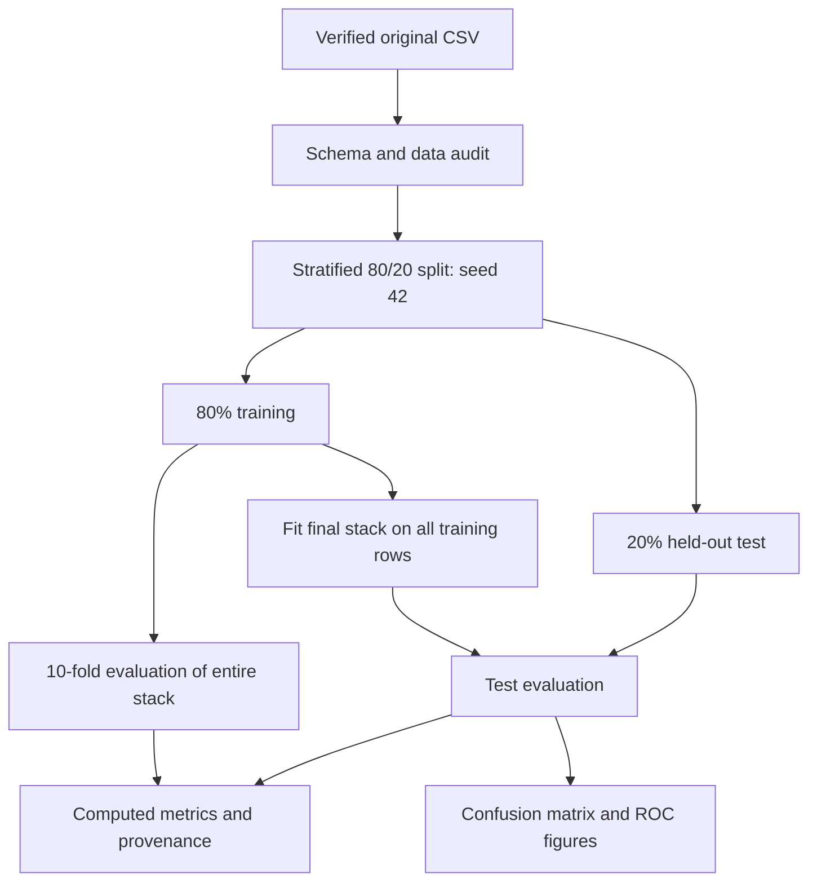

# Architecture

Inside each stack: separate preprocessing pipelines feed Decision Tree, Gradient Boosting and AdaBoost. Five-fold out-of-fold positive probabilities train Logistic Regression. Test rows never train preprocessing or the meta-classifier.

`data.py` validates source input; `model.py` constructs the complete estimator; `evaluation.py` computes metrics/figures; `cli.py` owns splitting, CV, final fitting and run metadata. `reports/paper_reported.json` is static source evidence and is never read by training code. Tests generate local synthetic records only.
